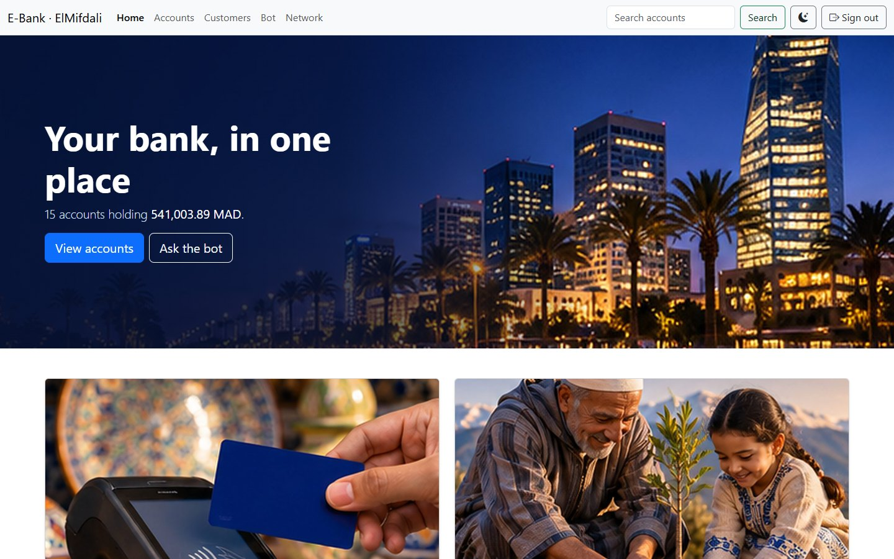
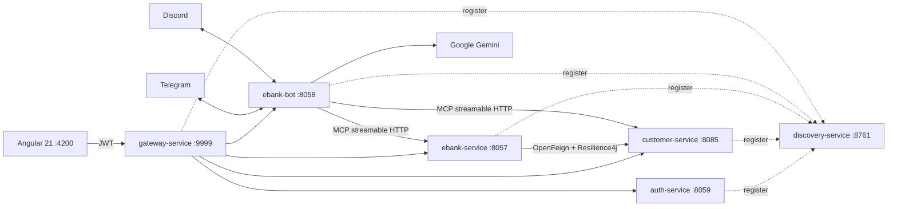
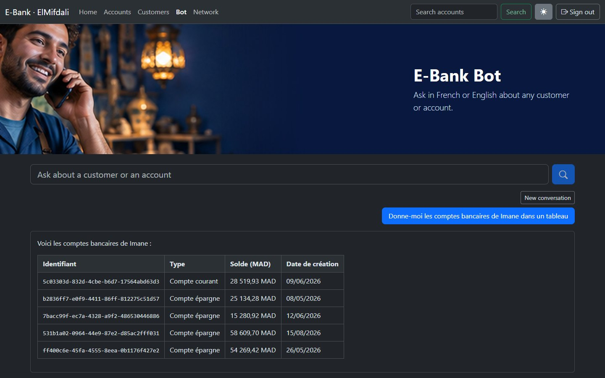
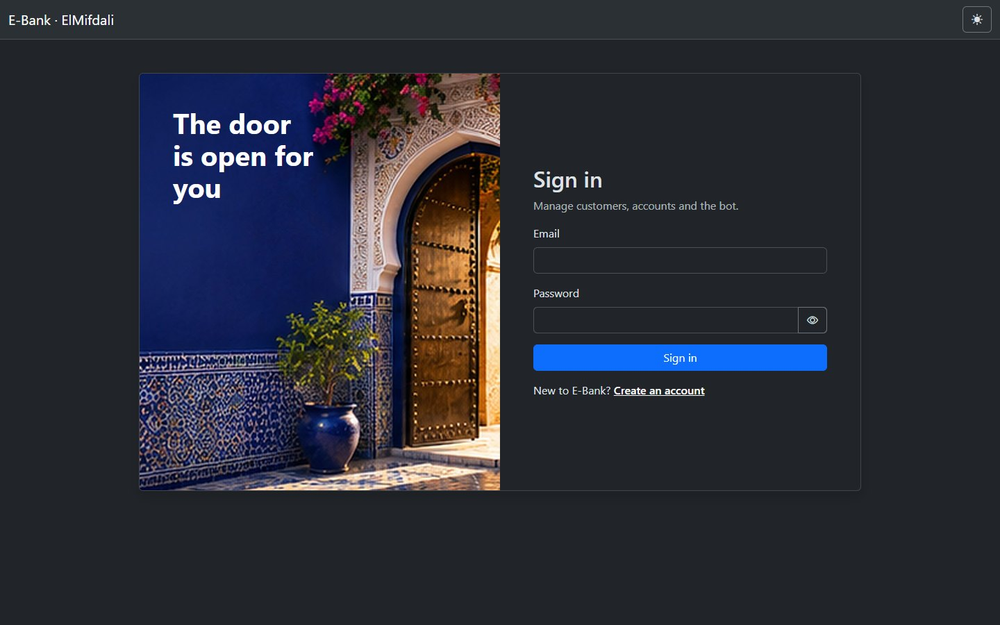
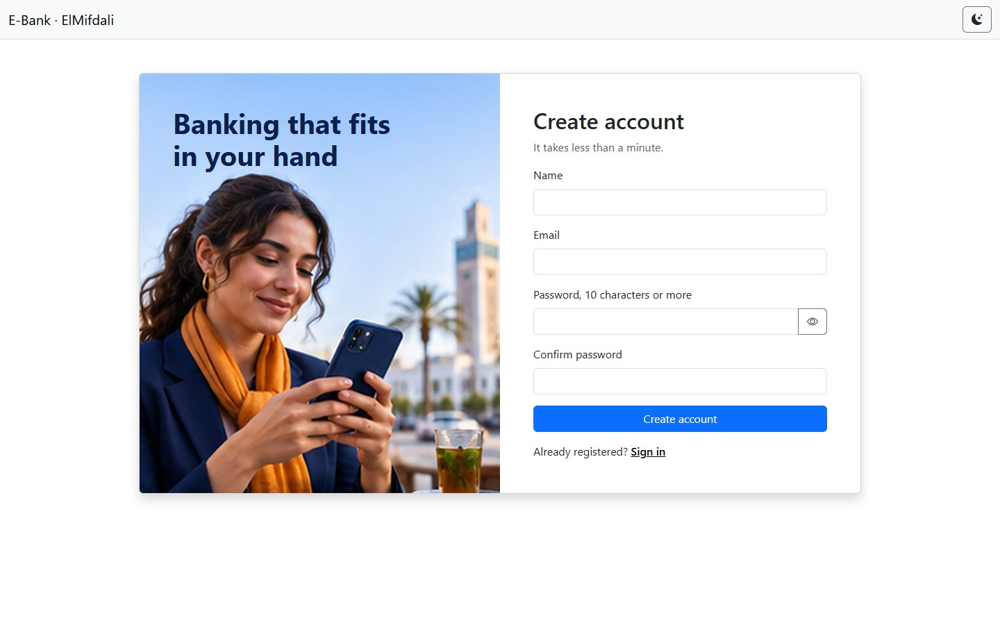
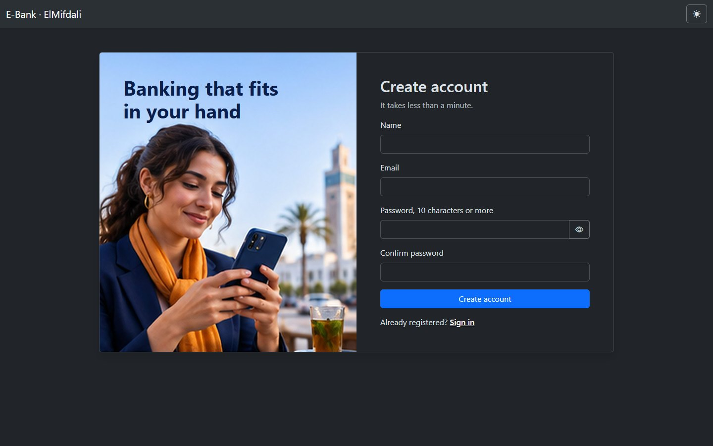
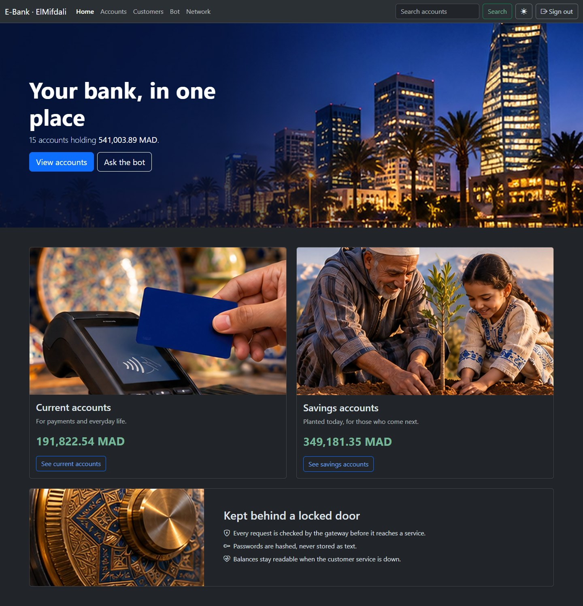
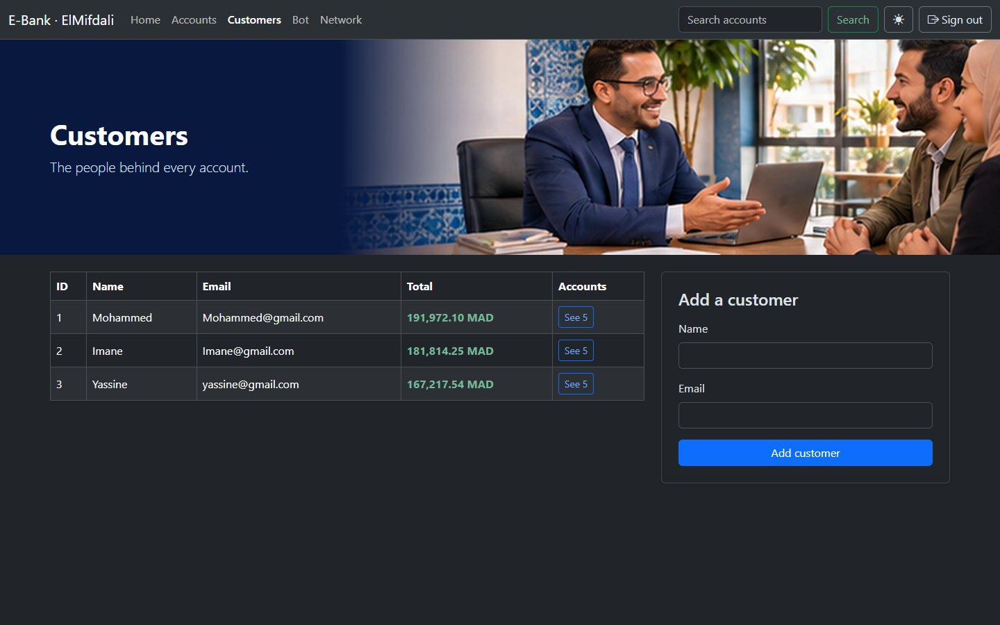
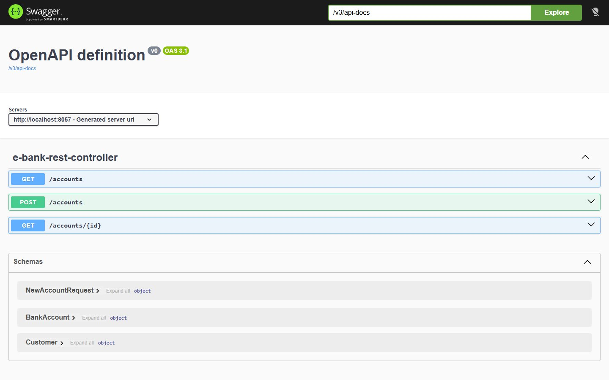

# E-Bank microservices

A banking application built with Spring Boot and Spring Cloud microservices, an AI agent (Spring AI, Gemini, MCP)
and an Angular 21 front end with Bootstrap 5 and photos, in light and dark mode.

**Author:** Mustapha El Mifdali ([Mustapha-ELMIFDALI](https://github.com/Mustapha-ELMIFDALI))



## Architecture



| Service | Port | Role | Data |
|---|---|---|---|
| `discovery-service` | 8761 | Eureka registry | |
| `gateway-service` | 9999 | Single entry point: dynamic routing, CORS, JWT check | |
| `auth-service` | 8059 | Sign up, sign in, JWT | H2 file, kept between restarts |
| `customer-service` | 8085 | Customers, REST and MCP | H2 in memory, seeded |
| `ebank-service` | 8057 | Bank accounts, REST and MCP | H2 in memory, seeded |
| `ebank-bot` | 8058 | AI agent: web, streaming, Telegram, Discord | conversation memory |
| `angular-front` | 4200 | Web application | |

Stack: Java 21, Spring Boot 4.1.1, Spring Cloud 2025.1.3, Spring AI 2.0.1, Angular 21.

## Run it

You need Java 21, Node 22 or newer and a [Gemini API key](https://aistudio.google.com/apikey).

```powershell
Copy-Item .env.example .env
```

Set `GEMINI_API_KEY` in `.env`, then:

```powershell
powershell -ExecutionPolicy Bypass -File scripts\start-all.ps1 -Build
```

Open <http://localhost:4200> and choose **Create an account**. There is no default user or password.
The script generates `JWT_SECRET` on the first start. To stop everything:

```powershell
powershell -ExecutionPolicy Bypass -File scripts\stop-all.ps1
```

From an IDE, start in this order: discovery, customer, ebank, auth, gateway, bot, then `npm start` in `angular-front`.
The bot comes after the two business services because it reads their MCP tools.

## Part 1: microservices

- **customer-service**: `GET /customers`, `GET /customers/{id}`, `POST /customers`.
- **ebank-service**: `GET /accounts`, `GET /accounts?customerId=`, `GET /accounts/{id}`, `POST /accounts`.
- **OpenFeign**: an account is returned with its owner, and cannot be created for a customer that does not exist (422).
- **Resilience4j**: while customer-service is down, accounts stay readable with a fallback owner. Creation is
  refused (503), because a fallback is not a proof that the customer exists. The circuit closes by itself afterwards.
- **Gateway**: routes are discovered from Eureka, `/SERVICE-NAME/path`.


### Test with Swagger and Postman

- Swagger: [customers](http://localhost:8085/swagger-ui/index.html), [accounts](http://localhost:8057/swagger-ui/index.html),
  [agent](http://localhost:8058/swagger-ui/index.html), [authentication](http://localhost:8059/swagger-ui/index.html).
- Postman: import [`docs/ebank.postman_collection.json`](docs/ebank.postman_collection.json) and run it from the top.
  The first request signs up and saves the token for the others.

## Part 2: AI agent and MCP

| MCP server | Tools |
|---|---|
| `http://localhost:8085/mcp` | `getAllCustomers`, `findCustomerById`, `saveCustomer` |
| `http://localhost:8057/mcp` | `getAllBankAccounts`, `getAccountsByCustomer`, `getBankAccountById`, `saveBankAccount` |

`ebank-bot` discovers these tools at startup. It has a memory per user and conversation and a system prompt that
limits it to the bank. `GET /chat` returns the whole answer and `GET /chatStream` streams it.

To test a server with an MCP client: in Postman choose **New > MCP**, transport HTTP, and enter one of the URLs above.

The default model is `gemini-3.5-flash-lite`. Set `GEMINI_MODEL` in `.env` to change it.



Telegram and Discord: see [docs/TELEGRAM_DISCORD.md](docs/TELEGRAM_DISCORD.md).

## Part 3: front end

- Signals, signal forms, HTTP interceptors, lazy routes, streamed Markdown answers.
- Bootstrap 5: navigation bar with search, tables with filters and sorting, and a photo for each page.
- Light and dark mode, responsive from 320 px, keyboard navigation and accessible contrast.

## Security

- Passwords are hashed with BCrypt. Five failed sign-ins lock an email for five minutes.
- The gateway refuses requests without a valid token and denies every route it does not list
  (`/mcp`, H2 console, internal actuator endpoints).
- Every service listens on `127.0.0.1` only. The H2 console is off unless `H2_CONSOLE=true`.
- Telegram and Discord only answer the user ids listed in `.env`.

Known limits, acceptable for a local demonstration:

- The direct ports (8085, 8057, 8058) need no token, so that Swagger and MCP clients can be used on this machine.
  Do not publish them.
- There are no roles: everybody who signs up is a banker and sees every customer.
- The token is kept in `localStorage`. For production, use an identity provider such as Keycloak.

## Screens

| | Light | Dark |
|---|---|---|
| Sign in |  |  |
| Sign up |  |  |
| Home |  |  |
| Accounts |  |  |
| Customers |  |  |
| Bot |  |  |
| Network |  |  |
| Mobile |  |  |

| Eureka | Swagger |
|---|---|
|  |  |

All captures are in [docs/screens](docs/screens). The photos in the application are AI-generated illustrations.

## Tests

Run `.\mvnw.cmd test` in each service folder, and `npm test` in `angular-front`.
