# E-Bank: microservices, AI agent and MCP

A banking application built with **Spring Boot / Spring Cloud** microservices, an **AI agent** (Spring AI, Google Gemini)
connected to the services with **MCP**, an **Angular 21** web application and a **Telegram** bot.

**Author:** Mustapha El Mifdali ([Mustapha-ELMIFDALI](https://github.com/Mustapha-ELMIFDALI))


## Contents

1. [Assignment checklist](#1-assignment-checklist)
2. [Architecture](#2-architecture)
3. [Project structure](#3-project-structure)
4. [Installation and start](#4-installation-and-start)
5. [Part 1: microservices](#5-part-1-microservices)
6. [Part 2: AI agent, MCP and bots](#6-part-2-ai-agent-mcp-and-bots)
7. [Part 3: Angular front end](#7-part-3-angular-front-end)
8. [Security](#8-security)
9. [Tests and results](#9-tests-and-results)
10. [Troubleshooting](#10-troubleshooting)
11. [Known limits](#11-known-limits)

---

## 1. Assignment checklist

### Part 1 ([video](https://www.youtube.com/watch?v=cdFz3VemT1Q))

| Requirement | Status | Evidence |
|---|---|---|
| Develop customer-service | Done | [5.1](#51-customer-service) |
| Develop ebank-service | Done | [5.2](#52-ebank-service) |
| Communication with OpenFeign | Done and tested | [5.3](#53-openfeign) |
| Fault tolerance with Resilience4j | Done and tested | [5.4](#54-circuit-breaker-with-resilience4j) |
| Develop the gateway | Done and tested | [5.5](#55-gateway) |
| Develop the discovery service | Done and tested | [5.6](#56-discovery-service) |
| Test with Postman and Swagger UI | Done | [5.7](#57-tests-with-swagger-ui-and-postman) |

### Part 2 ([video](https://www.youtube.com/watch?v=JHvxSZTWSsY))

| Requirement | Status | Evidence |
|---|---|---|
| AI agent based on Spring AI | Done and tested | [6.1](#61-the-agent) |
| Expose the microservices through MCP | Done and tested | [6.2](#62-mcp-servers) |
| Test the microservices with an MCP client | Done | [6.3](#63-test-with-an-mcp-client) |
| Connect the chatbot to the microservices with MCP | Done and tested | [6.1](#61-the-agent) |
| Test the chatbot with a REST client | Done | [6.4](#64-test-the-chatbot-with-a-rest-client) |
| Test the chatbot with a Telegram client | Done, tested in Telegram | [6.5](#65-test-the-chatbot-with-telegram) |
| Test the chatbot with a Discord client | Code and unit tests done, **live test pending** | [6.6](#66-discord) |

### Added to the project

| Feature | Evidence |
|---|---|
| Angular web application with streaming chat, light and dark mode | [7](#7-part-3-angular-front-end) |
| Sign up and sign in with BCrypt and JWT | [8](#8-security) |
| Repeatable API and security tests | [9](#9-tests-and-results) |

---

## 2. Architecture

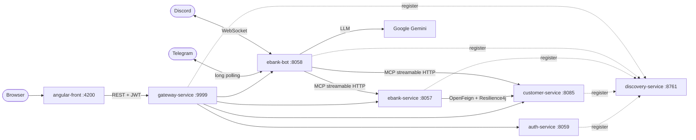

| Service | Port | Role | Data |
|---|---|---|---|
| `discovery-service` | 8761 | Eureka registry | none |
| `gateway-service` | 9999 | Single entry point: dynamic routing, CORS, JWT check | none |
| `auth-service` | 8059 | Sign up, sign in, JWT | H2 file, kept between restarts |
| `customer-service` | 8085 | Customers through REST and MCP | H2 in memory, 3 customers seeded |
| `ebank-service` | 8057 | Bank accounts through REST and MCP | H2 in memory, 15 accounts seeded |
| `ebank-bot` | 8058 | AI agent for web, Telegram and Discord | conversation memory |
| `angular-front` | 4200 | Web application | none |

### How a question is answered

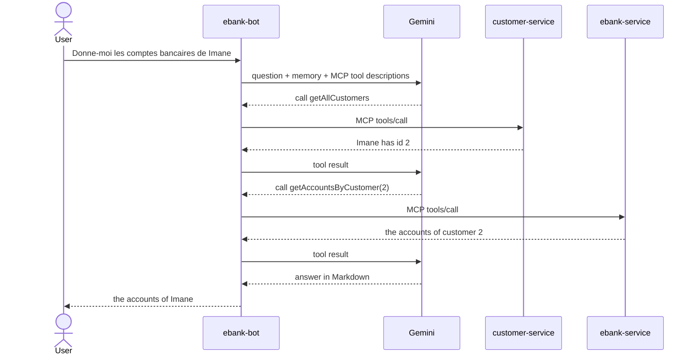

### Technologies

| Layer | Technologies |
|---|---|
| Language | Java 21, TypeScript |
| Back end | Spring Boot 4.1.1, Spring Data JPA, H2, Lombok, springdoc |
| Microservices | Spring Cloud 2025.1.3: Gateway, Eureka, OpenFeign, Resilience4j |
| AI | Spring AI 2.0.1, Google Gemini, MCP (streamable HTTP) |
| Security | Spring Security, OAuth2 resource server, JWT, BCrypt |
| Bots | TelegramBots 10.3, JDA 6.4 (Discord) |
| Front end | Angular 21 (signals, signal forms), Bootstrap 5, ngx-markdown |

---

## 3. Project structure

```text
ebank-ms-app/
├── discovery-service/      Eureka server
├── gateway-service/        gateway and security rules
├── auth-service/           users, BCrypt, JWT
├── customer-service/
│   └── .../customerservice
│       ├── entities/       Customer
│       ├── repository/     Spring Data
│       ├── service/        business layer
│       ├── controllers/    REST API
│       └── mcp/            MCP tools
├── ebank-service/
│   └── .../ebankservice
│       ├── entities/       BankAccount, AccountType
│       ├── model/          Customer (not stored here)
│       ├── feign/          OpenFeign client and fallback
│       ├── dtos/           validated request
│       ├── repository/ service/ controllers/
│       └── mcp/            MCP tools
├── ebank-bot/
│   └── .../ebankbot
│       ├── agents/         the agent
│       ├── controllers/    /chat and /chatStream
│       ├── telegram/       Telegram connector
│       └── discord/        Discord connector
├── angular-front/          web application
├── tests/                  end-to-end and security tests
├── scripts/                start-all and stop-all
├── docs/                   screenshots, Postman collection, bot guide
└── .env.example            configuration template
```

---

## 4. Installation and start

**Requirements:** Windows, Java 21, Node 22 or newer, and a [Gemini API key](https://aistudio.google.com/apikey).

**1. Create the configuration**

```powershell
Copy-Item .env.example .env
```

| Variable | Required | Purpose |
|---|---|---|
| `GEMINI_API_KEY` | yes | Access to Gemini |
| `JWT_SECRET` | generated | Signs the login tokens, created by the start script |
| `GEMINI_MODEL` | no | Default: `gemini-3.5-flash-lite` |
| `TELEGRAM_BOT_TOKEN` | no | Turns the Telegram bot on |
| `TELEGRAM_ALLOWED_USERS` | with Telegram | Ids allowed to use the bot |
| `DISCORD_BOT_TOKEN` | no | Turns the Discord bot on |
| `DISCORD_ALLOWED_USERS` | with Discord | Ids allowed to use the bot |

`.env` is ignored by git. Never commit it.

**2. Start everything**

```powershell
powershell -ExecutionPolicy Bypass -File scripts\start-all.ps1 -Build
```

`-Build` is only needed the first time and after a change in the Java code.

**3. Open <http://localhost:4200>** and choose **Create an account**. There is no default user or password.

**4. Stop everything**

```powershell
powershell -ExecutionPolicy Bypass -File scripts\stop-all.ps1
```

From an IDE, start in this order: discovery, customer, ebank, auth, gateway, bot, then `npm start` in `angular-front`.
The bot comes after the two business services because it reads their MCP tools when it starts.

---

## 5. Part 1: microservices

### 5.1 customer-service

| Method | Path | Result |
|---|---|---|
| GET | `/customers` | All customers |
| GET | `/customers/{id}` | One customer, 404 if unknown |
| POST | `/customers` | Create: `{"name":"Hajar","email":"hajar@example.com"}` |


### 5.2 ebank-service

| Method | Path | Result |
|---|---|---|
| GET | `/accounts` | All accounts |
| GET | `/accounts?customerId=2` | The accounts of one customer |
| GET | `/accounts/{id}` | One account with its owner |
| POST | `/accounts` | Create: `{"balance":4000,"type":"SAVING_ACCOUNT","customerId":2}` |

Types: `CURRENT_ACCOUNT`, `SAVING_ACCOUNT`. The id and the date are set by the service.


### 5.3 OpenFeign

An account only stores `customerId`. When one account is read, ebank-service asks customer-service for the owner,
by name, through Eureka:

```java
@FeignClient(name = "CUSTOMER-SERVICE")
public interface CustomerRestClient {

    @GetMapping("/customers/{id}")
    @CircuitBreaker(name = "customerService", fallbackMethod = "getDefaultCustomer")
    Customer getCustomerById(@PathVariable("id") Long id);
}
```

The response below contains the `customer` object returned through Feign. An account cannot be created for a
customer that does not exist (422).


### 5.4 Circuit breaker with Resilience4j

Test: stop customer-service, then read an account several times.

**The account is still returned, with a fallback customer:**

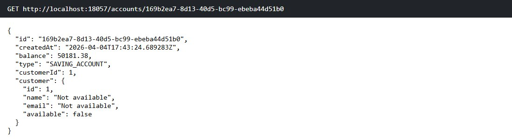

**After the failures the circuit is OPEN and the calls are no longer sent:**


**The web application tells the user:**

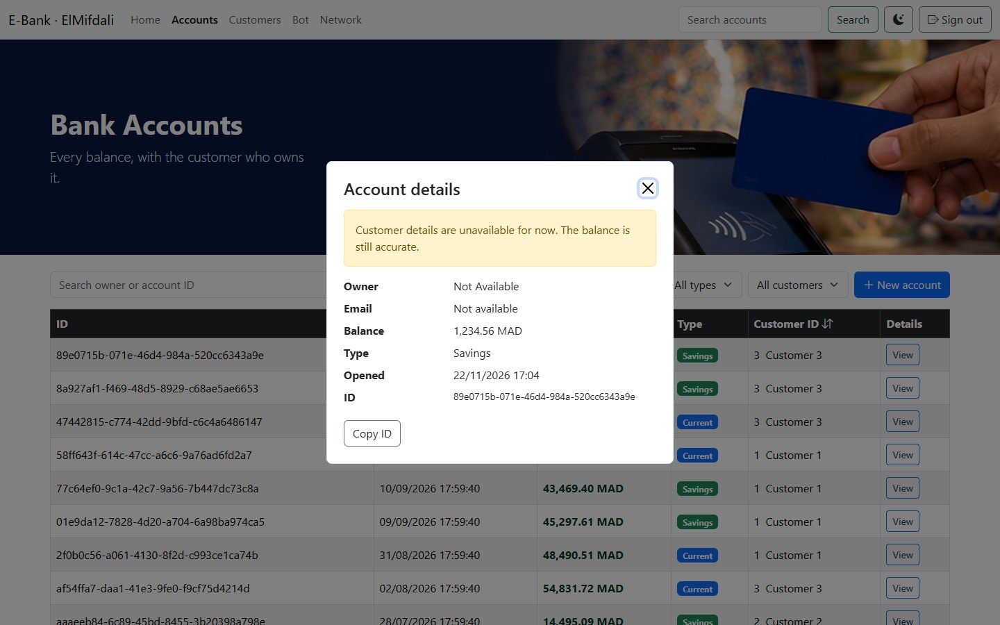

Creating an account during the outage is refused (503), because a fallback does not prove that the customer exists.
When customer-service is back, the circuit closes by itself.

### 5.5 Gateway

The routes are created from the Eureka registry:

```java
@Bean
DiscoveryClientRouteDefinitionLocator dynamicRoutes(ReactiveDiscoveryClient rdc, DiscoveryLocatorProperties dlp) {
    return new DiscoveryClientRouteDefinitionLocator(rdc, dlp);
}
```

| Through the gateway | Service |
|---|---|
| `http://localhost:9999/AUTH-SERVICE/auth/login` | auth-service |
| `http://localhost:9999/CUSTOMER-SERVICE/customers` | customer-service |
| `http://localhost:9999/EBANK-SERVICE/accounts` | ebank-service |
| `http://localhost:9999/EBANK-BOT/chatStream?query=...` | ebank-bot |

Business routes need the header `Authorization: Bearer <token>`. A browser that opens them directly receives 401.

### 5.6 Discovery service

All the services register at <http://localhost:8761>.


### 5.7 Tests with Swagger UI and Postman

| Swagger UI | Address |
|---|---|
| customer-service | <http://localhost:8085/swagger-ui/index.html> |
| ebank-service | <http://localhost:8057/swagger-ui/index.html> |
| ebank-bot | <http://localhost:8058/swagger-ui/index.html> |
| auth-service | <http://localhost:8059/swagger-ui/index.html> |

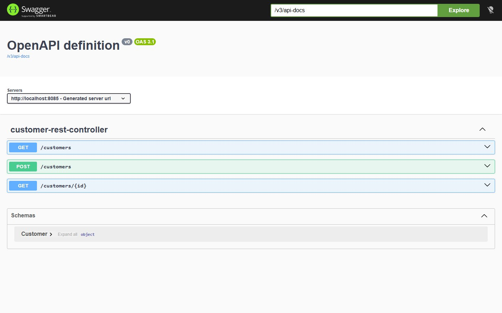

**Postman:** import [docs/ebank.postman_collection.json](docs/ebank.postman_collection.json) and run it from the top.
The first request signs up and saves the token for the others. Result of the collection, run with Newman, the
command line runner of Postman (15 assertions, 0 failed):


---

## 6. Part 2: AI agent, MCP and bots

### 6.1 The agent

```java
this.chatClient = builder
        .defaultSystem(systemPrompt, StandardCharsets.UTF_8)
        .defaultAdvisors(MessageChatMemoryAdvisor.builder(chatMemory).build())
        .defaultToolCallbacks(tools)
        .build();
```

- **System prompt** ([system.md](ebank-bot/src/main/resources/prompts/system.md)): it only answers about the bank,
  otherwise it says *Je ne sais pas*.
- **Memory:** LLMs are stateless, so the agent keeps one memory per user and conversation.
- **Tools:** discovered at startup on the two MCP servers.
- **Streaming:** `/chat` returns the whole answer, `/chatStream` sends it while it is generated.

### 6.2 MCP servers

| Server | Tool | Purpose |
|---|---|---|
| `http://localhost:8085/mcp` | `getAllCustomers` | List the customers |
| | `findCustomerById` | Find one customer |
| | `saveCustomer` | Create a customer |
| `http://localhost:8057/mcp` | `getAllBankAccounts` | List the accounts |
| | `getAccountsByCustomer` | The accounts of one customer |
| | `getBankAccountById` | One account with its owner |
| | `saveBankAccount` | Create an account |

```java
@McpTool(name = "findCustomerById", description = "Find one customer by id")
public Customer findCustomerById(@McpToolParam(description = "The numeric customer id") Long id) {
    return customerService.findCustomerById(id);
}
```

### 6.3 Test with an MCP client

```powershell
npx @modelcontextprotocol/inspector@0.20.0
```

Choose **Streamable HTTP**, enter the URL of a server, then **Connect**, **Tools**, **List Tools** and **Run Tool**.

**customer-service: 3 tools, `getAllCustomers` executed**

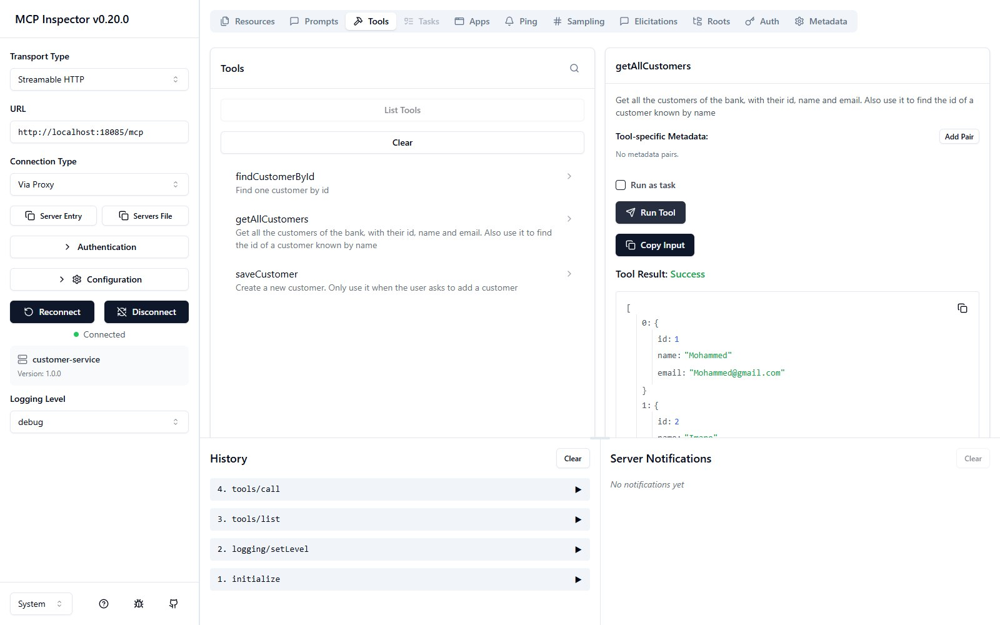

**ebank-service: 4 tools, `getAllBankAccounts` executed**

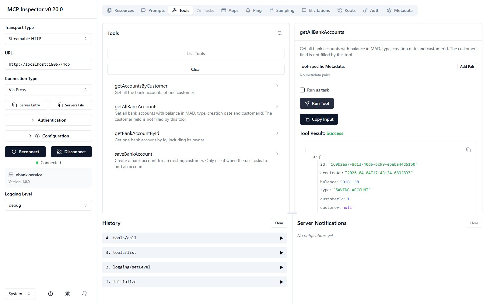

### 6.4 Test the chatbot with a REST client

The question *Liste des clients* is sent to `/chat`. The agent calls customer-service through MCP:


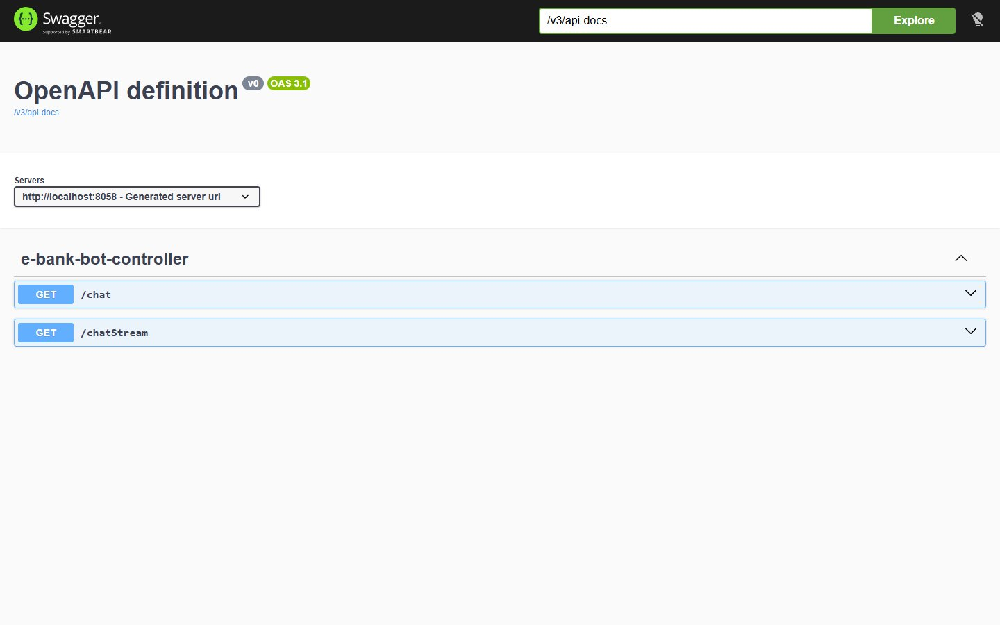

### 6.5 Test the chatbot with Telegram


| Step | Message | Result | Verified |
|---|---|---|---|
| 1 | `/start` before being allowed | Refused, the bot shows the user id (hidden in the picture) | closed by default |
| 2 | `Liste des clients` | 3 customers | same as the customer-service database |
| 3 | `Donne-moi les comptes bancaires de Imane` | 5 accounts | same ids, balances and dates as ebank-service |
| 4 | `Ajoute un compte épargne de 4000 MAD pour le client 2` | Account created | found in ebank-service with the same id |

Telegram cannot draw tables, so the connector shows the rows as lines separated by dots.
Setup: [docs/TELEGRAM_DISCORD.md](docs/TELEGRAM_DISCORD.md).

### 6.6 Discord

The connector is implemented and covered by unit tests (mentions, other bots ignored, allow list).
It has **not been tested with a real Discord bot yet**: it starts when `DISCORD_BOT_TOKEN` is set.
Setup: [docs/TELEGRAM_DISCORD.md](docs/TELEGRAM_DISCORD.md).

---

## 7. Part 3: Angular front end

- Navigation bar with search, tables with filters and sorting, forms with validation (signal forms).
- HTTP interceptors for the token and the loading indicator, guards on the pages, lazy routes.
- Streamed answers displayed as Markdown.
- Light and dark mode, responsive from 320 px.
- The photos are AI-generated illustrations.

### Sign in and sign up

| | Light | Dark |
|---|---|---|
| Sign in | 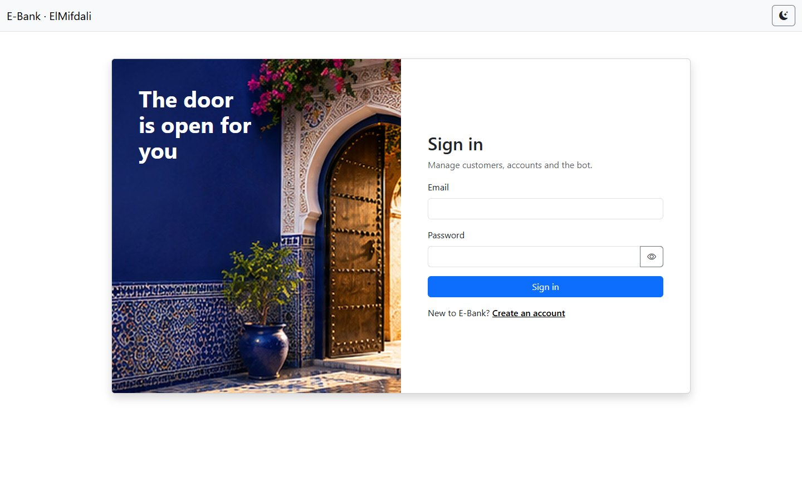 |  |
| Sign up |  |  |

### Home

| Light | Dark |
|---|---|
| 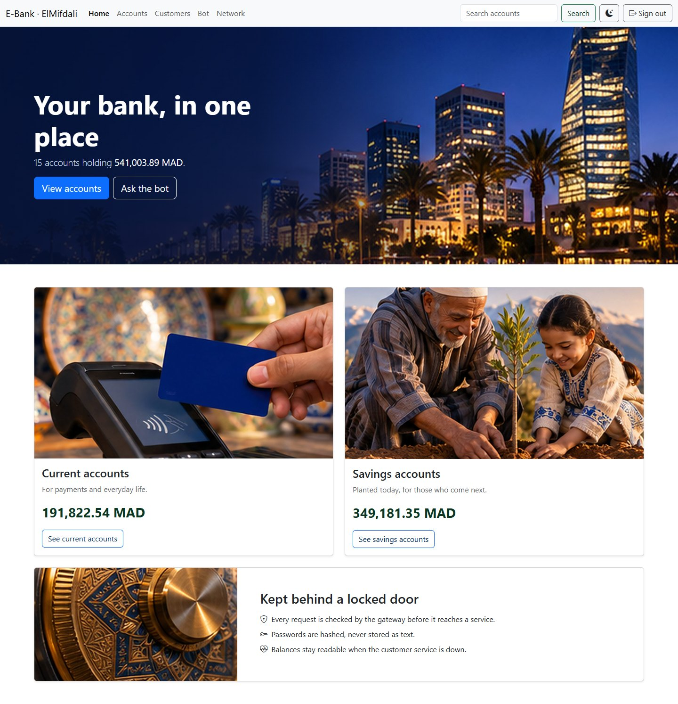 |  |
|  | 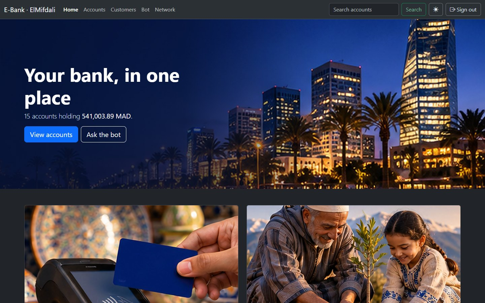 |

### Accounts

| Light | Dark |
|---|---|
|  |  |
| New account  | Details with the owner 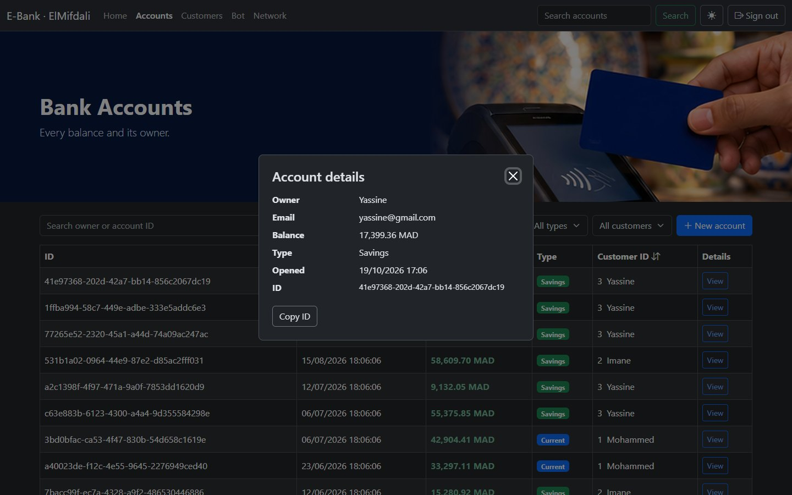 |
| No result 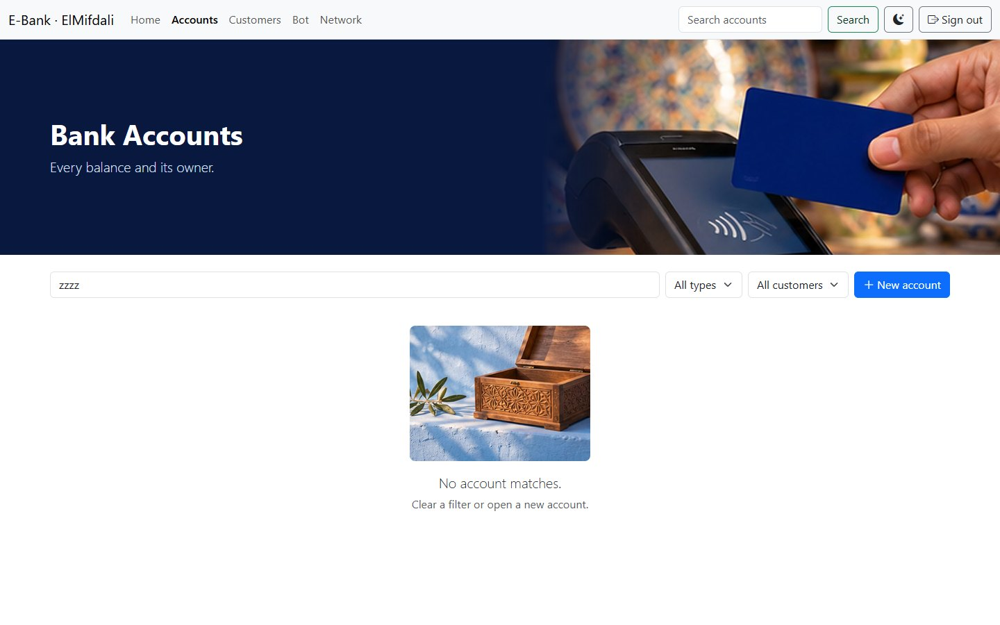 | |

### Customers

| Light | Dark |
|---|---|
| 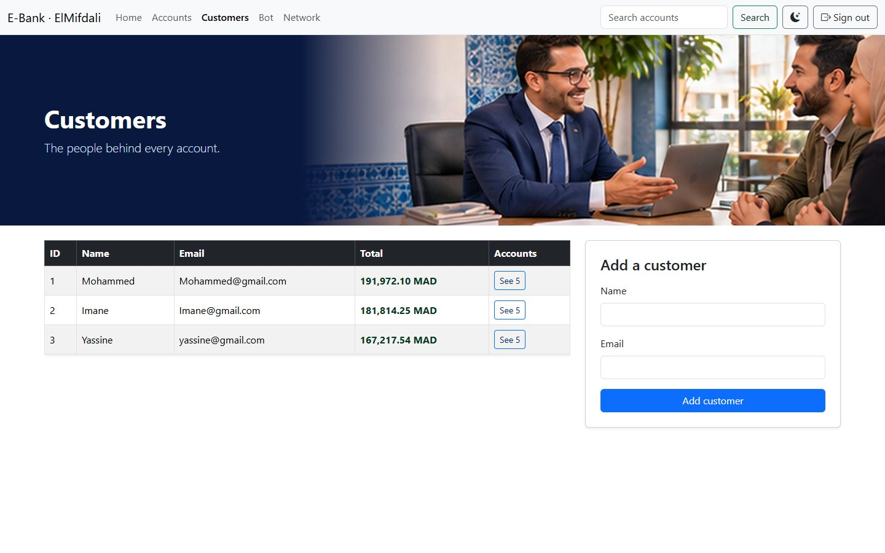 |  |

### Chatbot

| Light | Dark |
|---|---|
|  |  |
|  | |

### Network

| Light | Dark |
|---|---|
|  |  |

### Mobile

| Sign in | Sign up | Home | Menu |
|---|---|---|---|
|  |  |  |  |

| Accounts | Customers | Chatbot |
|---|---|---|
|  | 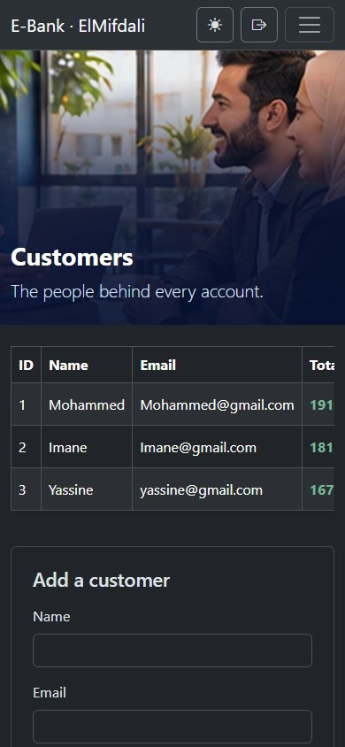 |  |

---

## 8. Security

| Protection | Detail |
|---|---|
| Passwords | Hashed with BCrypt, never returned by the API |
| Brute force | Five failed sign-ins lock the email for five minutes |
| Tokens | JWT HS256, valid 8 hours, verified by the gateway |
| Closed gateway | Every route that is not listed is denied: `/mcp`, H2 console, internal actuator |
| Network | Every service listens on `127.0.0.1` only |
| H2 console | Off unless `H2_CONSOLE=true` |
| Agent | A memory per verified user, and cross-site calls to the chat refused |
| Bots | Closed by default, only the ids listed in `.env` can use them |
| Secrets | Only in `.env`, which is ignored by git |

---

## 9. Tests and results

Results of 22 November 2026:

| Test | Passed | Failed | How to run it |
|---|---|---|---|
| Java unit and context tests | 24 | 0 | `.\mvnw.cmd test` in each service |
| Angular unit tests | 4 | 0 | `npm test` in `angular-front` |
| API, MCP and agent, end to end | 30 | 0 | `node tests/api.test.mjs` |
| Security attacks | 45 | 0 | `node tests/security.test.mjs` |
| Postman collection | 15 | 0 | Postman or Newman |

The two Node scripts need the application running. They create test users, a customer and an account, so use a
disposable user database: in the terminal that starts the application, run this first.

```powershell
$env:AUTH_DB_URL = 'jdbc:h2:mem:auth-test;DB_CLOSE_DELAY=-1'
```

The end-to-end captures come from a separate copy of the services on other ports (18085, 18057...), so that the
tests do not change the real data.

### Unit tests


### API, MCP and agent

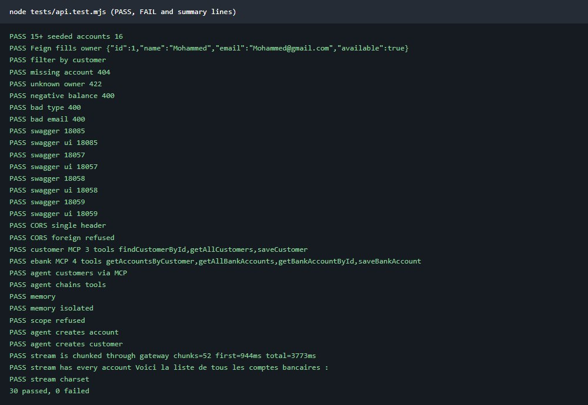

### Security

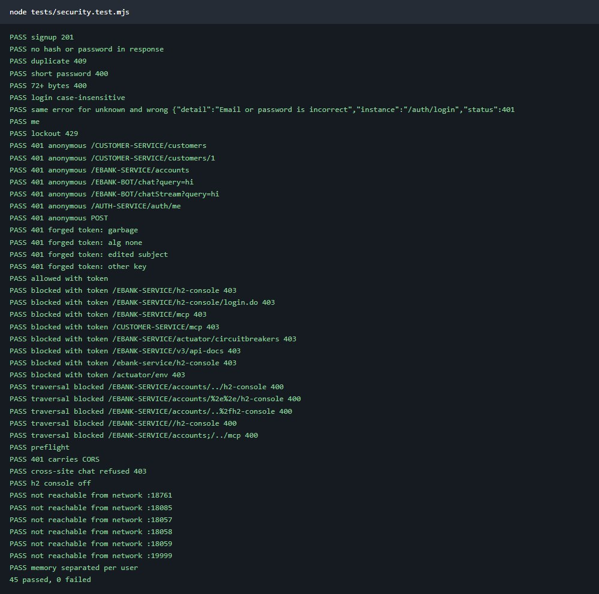

---

## 10. Troubleshooting

| Problem | Solution |
|---|---|
| `Ports already in use` | The application is already running, or run `scripts\stop-all.ps1` first |
| A service does not start | Read `.run\<service>.log` |
| 503 from the gateway just after the start | Wait 15 seconds for the Eureka registration |
| `127.0.0.1:4200` does not answer | Use `http://localhost:4200` |
| 401 on a gateway URL | Sign in and send the Bearer token |
| The bot says it is unavailable | Gemini is overloaded or over quota: wait, or change `GEMINI_MODEL` |
| Telegram answers *Accès non autorisé* | Add the id to `TELEGRAM_ALLOWED_USERS` and restart |
| `409 Conflict` from Telegram | Another program uses the same bot token |

## 11. Known limits

- Customers and accounts are in memory: a restart restores the demonstration data.
- The direct ports (8085, 8057, 8058) need no token, so that Swagger and MCP clients work on this machine. Do not publish them.
- There are no roles: everybody who signs up is a banker and sees every customer.
- The token is kept in `localStorage`. For production, use an identity provider such as Keycloak.
- The configuration service and Docker deployment are not part of this version.
- Discord still has to be tested with a real bot.
