# E-Bank : microservices, agent IA et MCP

Application bancaire basée sur des microservices **Spring Boot / Spring Cloud**, un **agent IA** (Spring AI, Google Gemini)
connecté aux services avec **MCP**, une application web **Angular 21** et un bot **Telegram**.

**Auteur :** Mustapha El Mifdali ([Mustapha-ELMIFDALI](https://github.com/Mustapha-ELMIFDALI))


## Sommaire

1. [Architecture](#1-architecture)
2. [Structure du projet](#2-structure-du-projet)
3. [Installation et démarrage](#3-installation-et-démarrage)
4. [Microservices (partie 1)](#4-microservices-partie-1)
5. [Agent IA, MCP et bots (partie 2)](#5-agent-ia-mcp-et-bots-partie-2)
6. [Frontend Angular (partie 3)](#6-frontend-angular-partie-3)
7. [Sécurité](#7-sécurité)
8. [Tests et résultats](#8-tests-et-résultats)
9. [Dépannage](#9-dépannage)
10. [Limites connues](#10-limites-connues)

## Fonctionnalités ajoutées au projet

| Fonctionnalité | Détails |
|---|---|
| Application web Angular avec chat en streaming, mode clair et mode sombre | [Partie 6](#6-frontend-angular-partie-3) |
| Inscription et connexion avec BCrypt et JWT | [Partie 7](#7-sécurité) |
| Tests reproductibles de l'API et de la sécurité | [Partie 8](#8-tests-et-résultats) |

---

## 1. Architecture

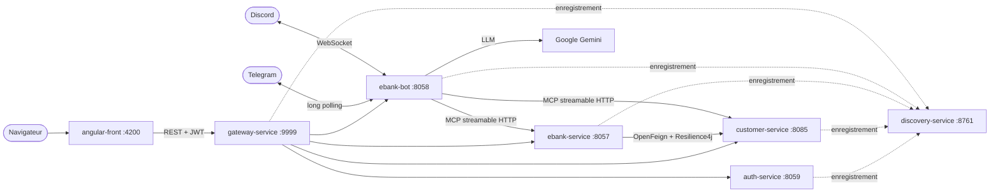

| Service | Port | Rôle | Données |
|---|---|---|---|
| `discovery-service` | 8761 | Annuaire Eureka | aucune |
| `gateway-service` | 9999 | Point d'entrée unique : routage dynamique, CORS, vérification du JWT | aucune |
| `auth-service` | 8059 | Inscription, connexion, JWT | fichier H2, conservé après un redémarrage |
| `customer-service` | 8085 | Gestion des clients via REST et MCP | H2 en mémoire, 3 clients insérés au démarrage |
| `ebank-service` | 8057 | Gestion des comptes bancaires via REST et MCP | H2 en mémoire, 15 comptes insérés au démarrage |
| `ebank-bot` | 8058 | Agent IA pour le web, Telegram et Discord | mémoire des conversations |
| `angular-front` | 4200 | Application web | aucune |

### Traitement d'une question

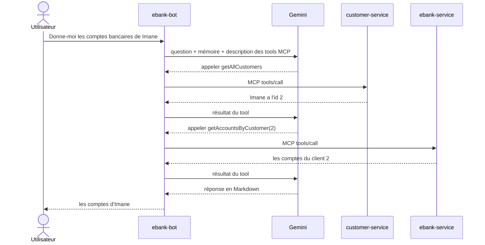

### Technologies utilisées

| Couche | Technologies |
|---|---|
| Langages | Java 21, TypeScript |
| Backend | Spring Boot 4.1.1, Spring Data JPA, H2, Lombok, springdoc |
| Microservices | Spring Cloud 2025.1.3 : Gateway, Eureka, OpenFeign, Resilience4j |
| Intelligence artificielle | Spring AI 2.0.1, Google Gemini, MCP (streamable HTTP) |
| Sécurité | Spring Security, OAuth2 Resource Server, JWT, BCrypt |
| Bots | TelegramBots 10.3, JDA 6.4 (Discord) |
| Frontend | Angular 21 (signals, signal forms), Bootstrap 5, ngx-markdown |

---

## 2. Structure du projet

```text
ebank-ms-app/
├── discovery-service/      serveur Eureka
├── gateway-service/        gateway et règles de sécurité
├── auth-service/           utilisateurs, BCrypt, JWT
├── customer-service/
│   └── .../customerservice
│       ├── entities/       Customer
│       ├── repository/     Spring Data
│       ├── service/        couche métier
│       ├── controllers/    API REST
│       └── mcp/            tools MCP
├── ebank-service/
│   └── .../ebankservice
│       ├── entities/       BankAccount, AccountType
│       ├── model/          Customer (non enregistré dans ce service)
│       ├── feign/          client OpenFeign et méthode de secours
│       ├── dtos/           requête validée
│       ├── repository/ service/ controllers/
│       └── mcp/            tools MCP
├── ebank-bot/
│   └── .../ebankbot
│       ├── agents/         agent IA
│       ├── controllers/    /chat et /chatStream
│       ├── telegram/       connecteur Telegram
│       └── discord/        connecteur Discord
├── angular-front/          application web
├── tests/                  tests de bout en bout et de sécurité
├── scripts/                start-all et stop-all
├── docs/                   captures, collection Postman, guide des bots
└── .env.example            modèle de configuration
```

---

## 3. Installation et démarrage

**Prérequis :** Windows, Java 21, Node 22 ou plus récent et une [clé API Gemini](https://aistudio.google.com/apikey).

**1. Créer la configuration**

```powershell
Copy-Item .env.example .env
```

| Variable | Obligatoire | Utilité |
|---|---|---|
| `GEMINI_API_KEY` | oui | Accès à Gemini |
| `JWT_SECRET` | générée | Signe les tokens de connexion, créée par le script de démarrage |
| `GEMINI_MODEL` | non | Valeur par défaut : `gemini-3.5-flash-lite` |
| `TELEGRAM_BOT_TOKEN` | non | Active le bot Telegram |
| `TELEGRAM_ALLOWED_USERS` | avec Telegram | Identifiants autorisés à utiliser le bot |
| `DISCORD_BOT_TOKEN` | non | Active le bot Discord |
| `DISCORD_ALLOWED_USERS` | avec Discord | Identifiants autorisés à utiliser le bot |

Le fichier `.env` est ignoré par Git. Il ne doit jamais être commité.

**2. Démarrer l'application**

```powershell
powershell -ExecutionPolicy Bypass -File scripts\start-all.ps1 -Build
```

L'option `-Build` n'est nécessaire que la première fois et après une modification du code Java.

**3. Ouvrir <http://localhost:4200>** et cliquer sur **Create an account** pour créer un compte.
Il n'existe aucun utilisateur ni mot de passe par défaut.

**4. Arrêter l'application**

```powershell
powershell -ExecutionPolicy Bypass -File scripts\stop-all.ps1
```

Depuis un IDE, respecter cet ordre : discovery, customer, ebank, auth, gateway, bot, puis `npm start` dans `angular-front`.
Le bot démarre après les deux services métier, car il récupère leurs tools MCP au démarrage.

---

## 4. Microservices (partie 1)

### 4.1 customer-service

| Méthode | Chemin | Résultat |
|---|---|---|
| GET | `/customers` | Tous les clients |
| GET | `/customers/{id}` | Un client, 404 s'il n'existe pas |
| POST | `/customers` | Création : `{"name":"Hajar","email":"hajar@example.com"}` |

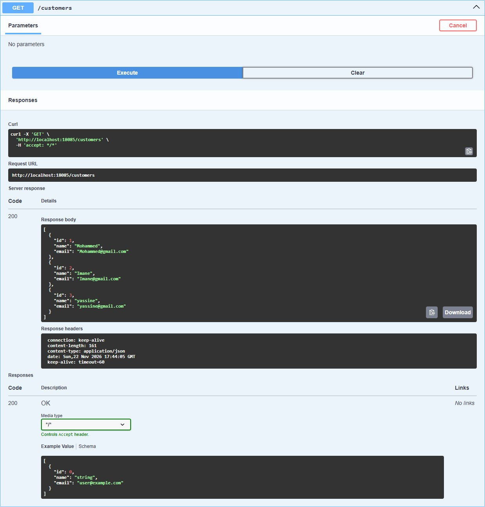

### 4.2 ebank-service

| Méthode | Chemin | Résultat |
|---|---|---|
| GET | `/accounts` | Tous les comptes |
| GET | `/accounts?customerId=2` | Les comptes d'un client |
| GET | `/accounts/{id}` | Un compte avec son propriétaire |
| POST | `/accounts` | Création : `{"balance":4000,"type":"SAVING_ACCOUNT","customerId":2}` |

Types de comptes : `CURRENT_ACCOUNT` (compte courant) et `SAVING_ACCOUNT` (compte épargne).
L'identifiant et la date de création sont générés par le service.


### 4.3 Communication avec OpenFeign

Un compte n'enregistre que `customerId`. Lors de la consultation d'un compte, ebank-service demande le propriétaire
à customer-service, par son nom, grâce à Eureka :

```java
@FeignClient(name = "CUSTOMER-SERVICE")
public interface CustomerRestClient {

    @GetMapping("/customers/{id}")
    @CircuitBreaker(name = "customerService", fallbackMethod = "getDefaultCustomer")
    Customer getCustomerById(@PathVariable("id") Long id);
}
```

La réponse ci-dessous contient l'objet `customer` récupéré avec Feign. Il est impossible de créer un compte pour
un client qui n'existe pas (erreur 422).

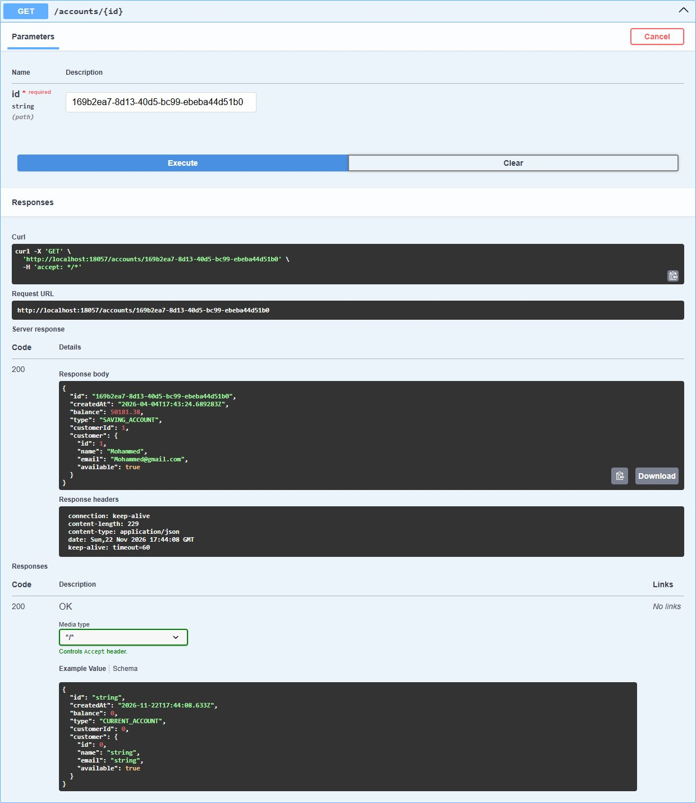

### 4.4 Tolérance aux pannes avec Resilience4j

Test réalisé : arrêter customer-service, puis consulter plusieurs fois un compte.

**Le compte est toujours retourné, avec un client par défaut :**


**Après les échecs, le circuit passe à l'état OPEN et les appels ne sont plus envoyés :**

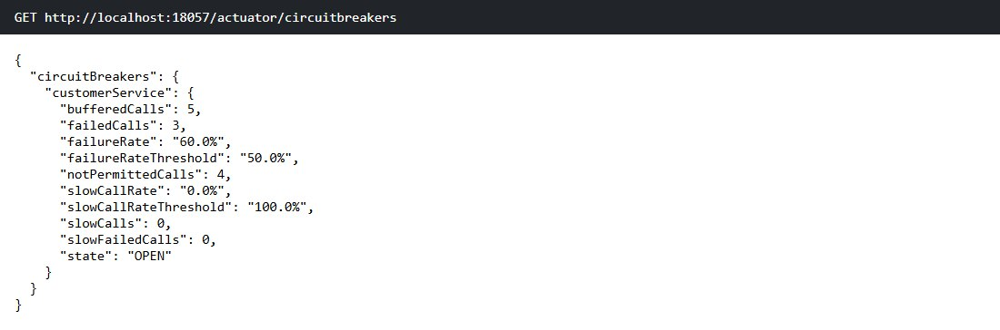

**L'application web informe l'utilisateur :**


Pendant la panne, la création d'un compte est refusée (erreur 503), car la réponse de secours ne prouve pas que
le client existe. Quand customer-service redevient disponible, le circuit se referme automatiquement.

### 4.5 Gateway

Les routes sont créées dynamiquement à partir de l'annuaire Eureka :

```java
@Bean
DiscoveryClientRouteDefinitionLocator dynamicRoutes(ReactiveDiscoveryClient rdc, DiscoveryLocatorProperties dlp) {
    return new DiscoveryClientRouteDefinitionLocator(rdc, dlp);
}
```

| Adresse via la gateway | Service |
|---|---|
| `http://localhost:9999/AUTH-SERVICE/auth/login` | auth-service |
| `http://localhost:9999/CUSTOMER-SERVICE/customers` | customer-service |
| `http://localhost:9999/EBANK-SERVICE/accounts` | ebank-service |
| `http://localhost:9999/EBANK-BOT/chatStream?query=...` | ebank-bot |

Les routes métier exigent l'en-tête `Authorization: Bearer <token>`. Un navigateur qui les ouvre directement reçoit
une erreur 401.

### 4.6 Discovery service

Tous les services s'enregistrent auprès d'Eureka : <http://localhost:8761>.

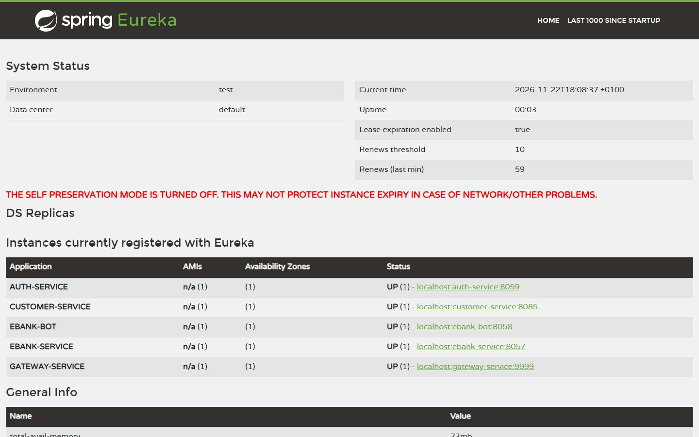

### 4.7 Tests avec Swagger UI et Postman

| Swagger UI | Adresse |
|---|---|
| customer-service | <http://localhost:8085/swagger-ui/index.html> |
| ebank-service | <http://localhost:8057/swagger-ui/index.html> |
| ebank-bot | <http://localhost:8058/swagger-ui/index.html> |
| auth-service | <http://localhost:8059/swagger-ui/index.html> |


**Postman :** importer [docs/ebank.postman_collection.json](docs/ebank.postman_collection.json) et exécuter la collection
depuis le début. La première requête crée un utilisateur et enregistre le token pour les suivantes. Résultat de la
collection, exécutée avec Newman, l'outil en ligne de commande de Postman (15 assertions, 0 échec) :

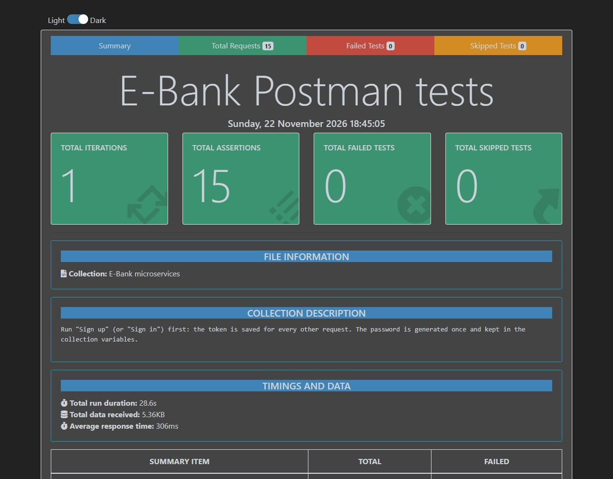

---

## 5. Agent IA, MCP et bots (partie 2)

### 5.1 Agent IA

```java
this.chatClient = builder
        .defaultSystem(systemPrompt, StandardCharsets.UTF_8)
        .defaultAdvisors(MessageChatMemoryAdvisor.builder(chatMemory).build())
        .defaultToolCallbacks(tools)
        .build();
```

- **Prompt système** ([system.md](ebank-bot/src/main/resources/prompts/system.md)) : l'agent répond uniquement aux
  questions sur la banque, sinon il répond *Je ne sais pas*.
- **Mémoire :** les LLM sont sans état (stateless), l'agent garde donc une mémoire par utilisateur et par conversation.
- **Tools :** ils sont découverts au démarrage sur les deux serveurs MCP.
- **Streaming :** `/chat` retourne la réponse complète, `/chatStream` l'envoie au fur et à mesure de sa génération.

### 5.2 Serveurs MCP

| Serveur | Tool | Utilité |
|---|---|---|
| `http://localhost:8085/mcp` | `getAllCustomers` | Lister les clients |
| | `findCustomerById` | Chercher un client |
| | `saveCustomer` | Créer un client |
| `http://localhost:8057/mcp` | `getAllBankAccounts` | Lister les comptes |
| | `getAccountsByCustomer` | Lister les comptes d'un client |
| | `getBankAccountById` | Consulter un compte avec son propriétaire |
| | `saveBankAccount` | Créer un compte |

```java
@McpTool(name = "findCustomerById", description = "Find one customer by id")
public Customer findCustomerById(@McpToolParam(description = "The numeric customer id") Long id) {
    return customerService.findCustomerById(id);
}
```

### 5.3 Test avec un client MCP

```powershell
npx @modelcontextprotocol/inspector@0.20.0
```

Choisir **Streamable HTTP**, saisir l'adresse d'un serveur, puis cliquer sur **Connect**, **Tools**, **List Tools**
et **Run Tool**.

**customer-service : 3 tools, exécution de `getAllCustomers`**


**ebank-service : 4 tools, exécution de `getAllBankAccounts`**


### 5.4 Test du chatbot avec un client REST

La question *Liste des clients* est envoyée à `/chat`. L'agent appelle customer-service via MCP :

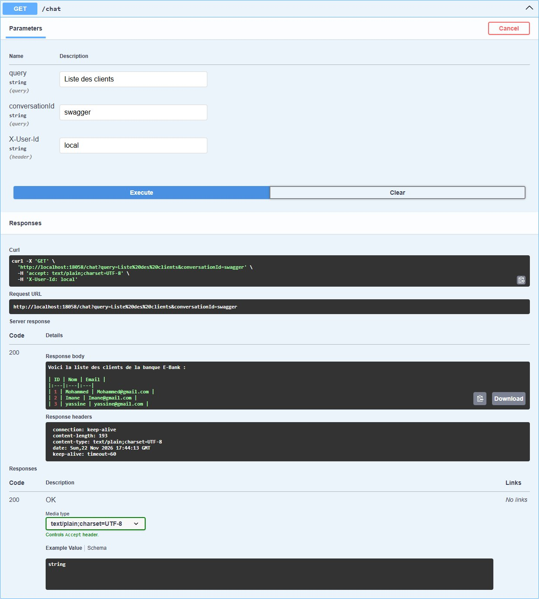


### 5.5 Test du chatbot avec Telegram

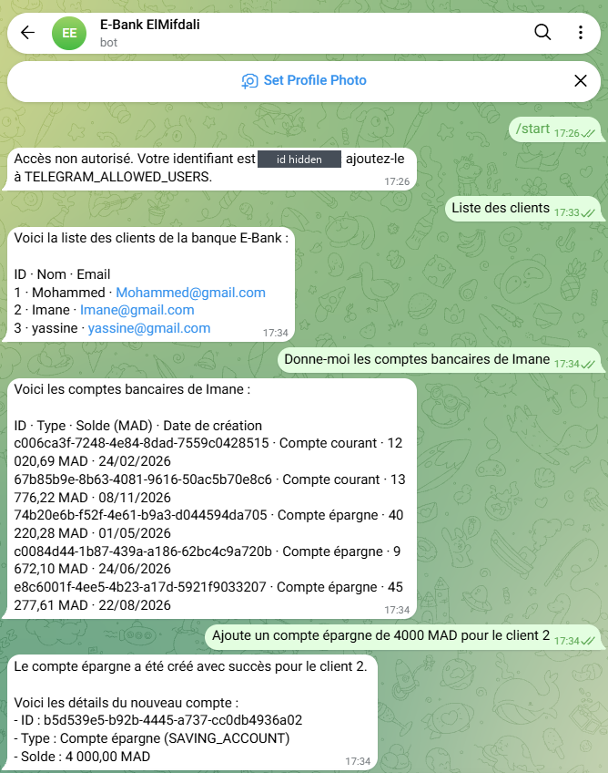

| Étape | Message | Résultat | Vérification |
|---|---|---|---|
| 1 | `/start` avant autorisation | Accès refusé, le bot affiche l'identifiant (masqué sur l'image) | bot fermé par défaut |
| 2 | `Liste des clients` | 3 clients | identiques à la base de customer-service |
| 3 | `Donne-moi les comptes bancaires de Imane` | 5 comptes | mêmes identifiants, soldes et dates que dans ebank-service |
| 4 | `Ajoute un compte épargne de 4000 MAD pour le client 2` | Compte créé | retrouvé dans ebank-service avec le même identifiant |

Telegram n'affiche pas les tableaux : le connecteur présente donc chaque ligne avec des valeurs séparées par des points.
Configuration : [guide Telegram et Discord](docs/TELEGRAM_DISCORD.md).

### 5.6 Discord

Le connecteur est développé et couvert par des tests unitaires (mentions, messages des autres bots ignorés, liste des
utilisateurs autorisés). Il **n'a pas encore été testé avec un vrai bot Discord**. Il s'active lorsque
`DISCORD_BOT_TOKEN` est renseigné.
Configuration : [guide Telegram et Discord](docs/TELEGRAM_DISCORD.md).

---

## 6. Frontend Angular (partie 3)

- Barre de navigation avec recherche, tableaux avec filtres et tri, formulaires avec validation (signal forms).
- Intercepteurs HTTP pour le token et l'indicateur de chargement, guards sur les pages, routes chargées à la demande.
- Réponses en streaming affichées en Markdown.
- Mode clair et mode sombre, interface responsive à partir de 320 px.
- Les photos sont des illustrations générées par intelligence artificielle.

### Connexion et inscription

| | Mode clair | Mode sombre |
|---|---|---|
| Connexion |  |  |
| Inscription |  |  |

### Accueil

| Mode clair | Mode sombre |
|---|---|
|  |  |
|  |  |

### Comptes bancaires

| Mode clair | Mode sombre |
|---|---|
| 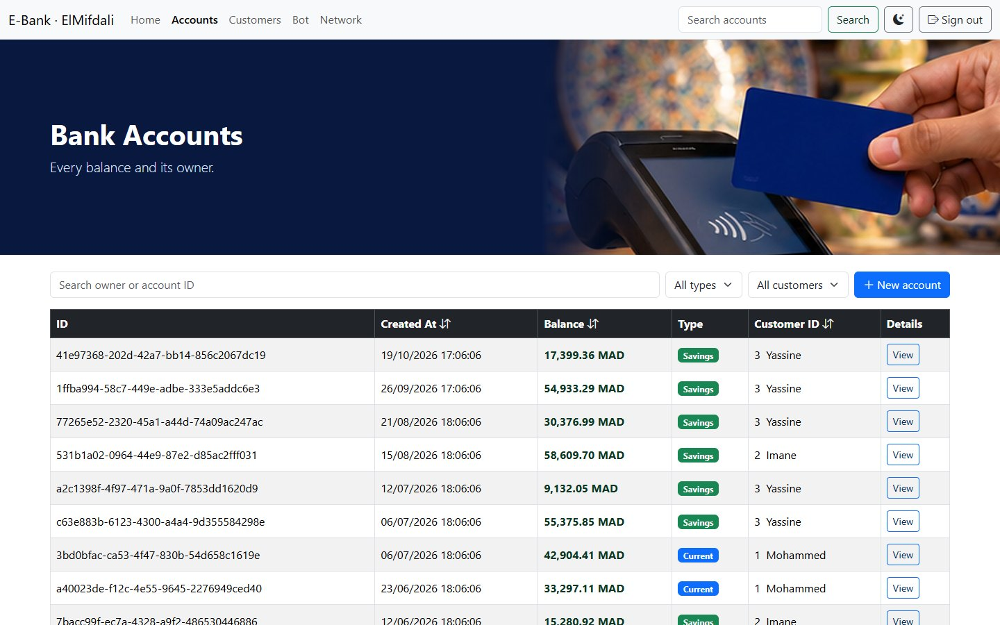 | 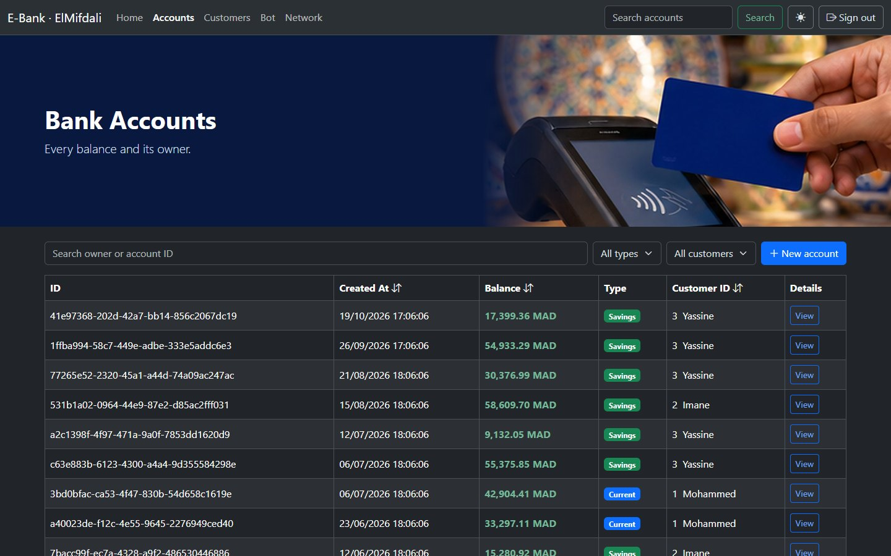 |
| Nouveau compte 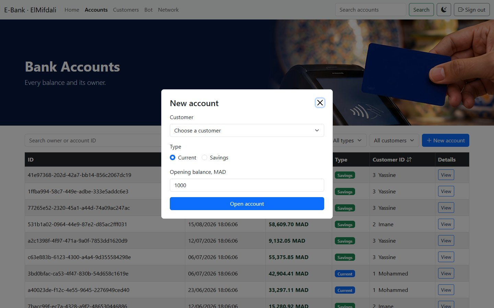 | Détails avec le propriétaire  |
| Aucun résultat  | |

### Clients

| Mode clair | Mode sombre |
|---|---|
|  |  |

### Chatbot

| Mode clair | Mode sombre |
|---|---|
| 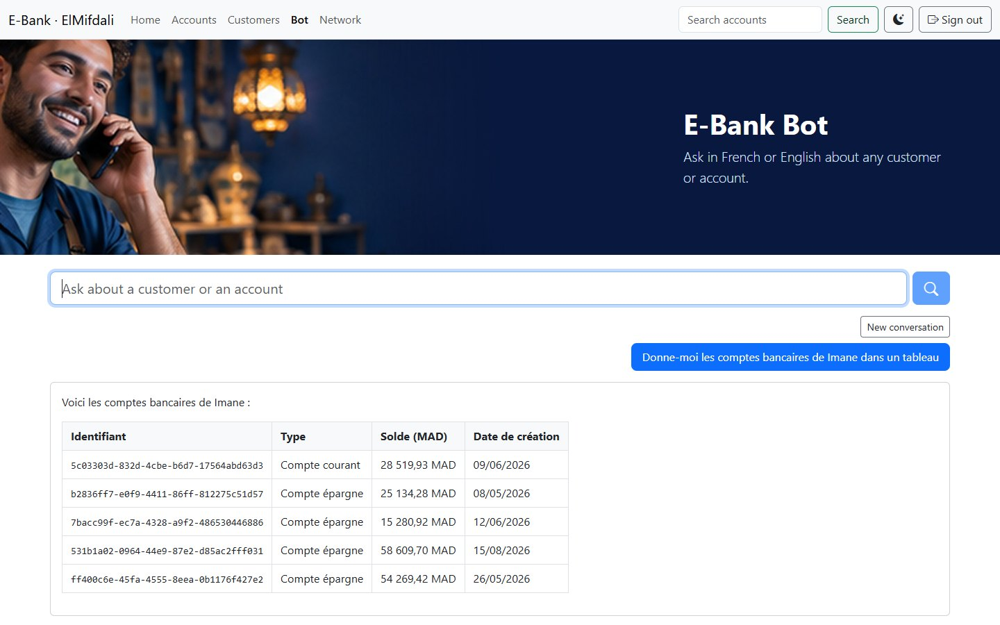 |  |
| 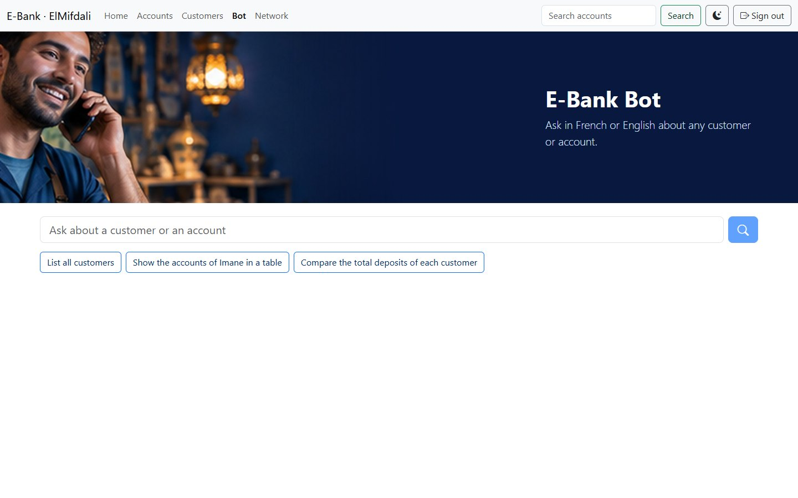 | |

### État des services

| Mode clair | Mode sombre |
|---|---|
| 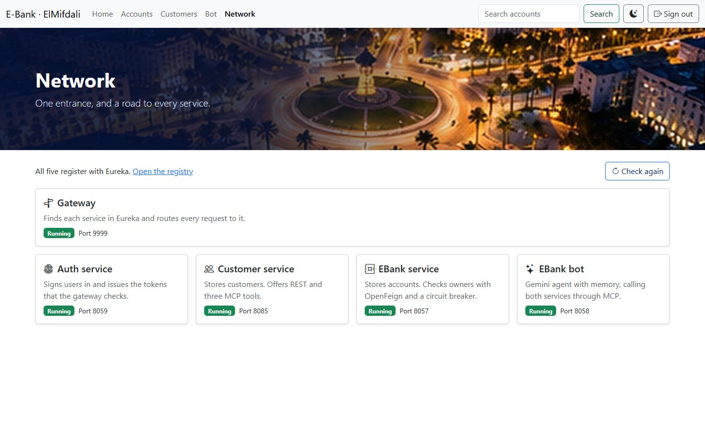 | 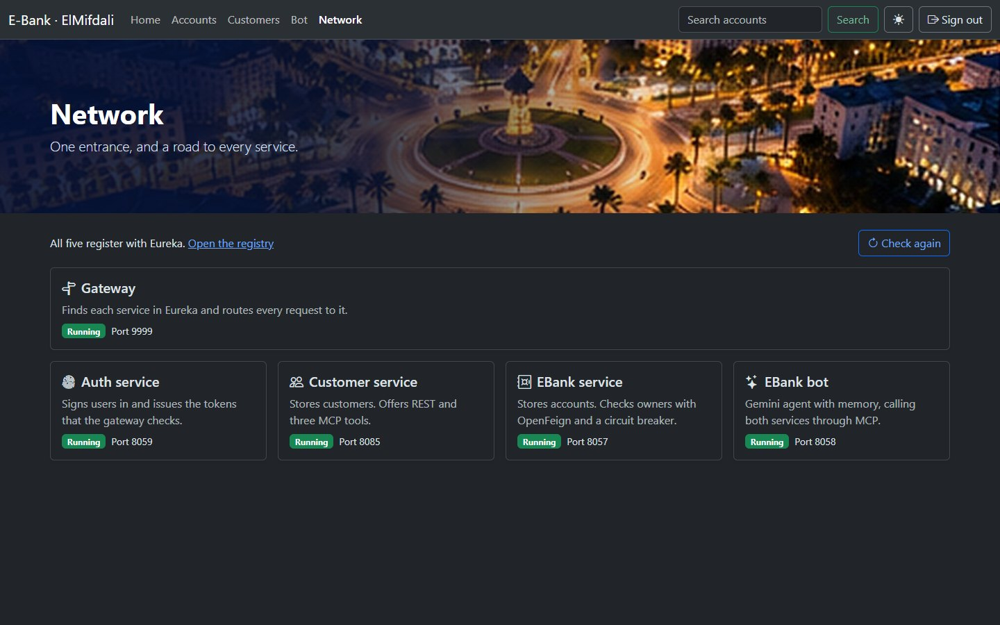 |

### Version mobile

| Connexion | Inscription | Accueil | Menu |
|---|---|---|---|
| 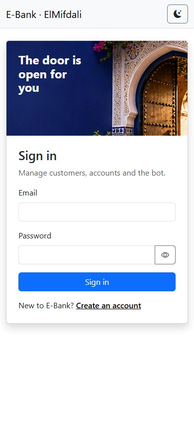 | 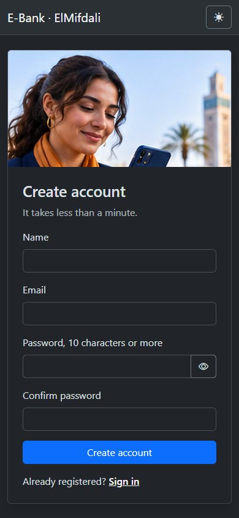 | 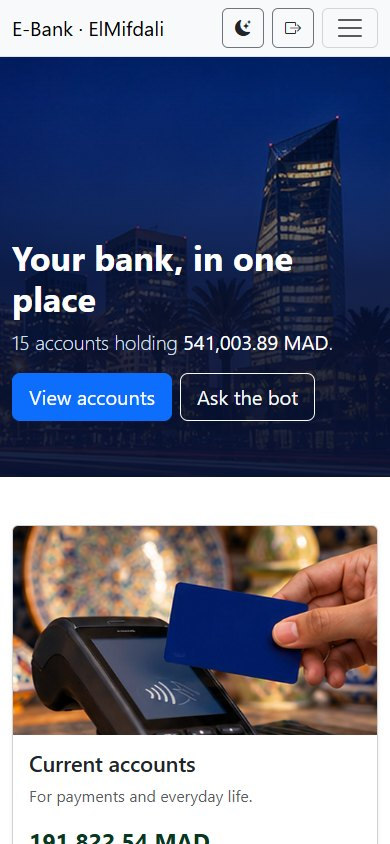 | 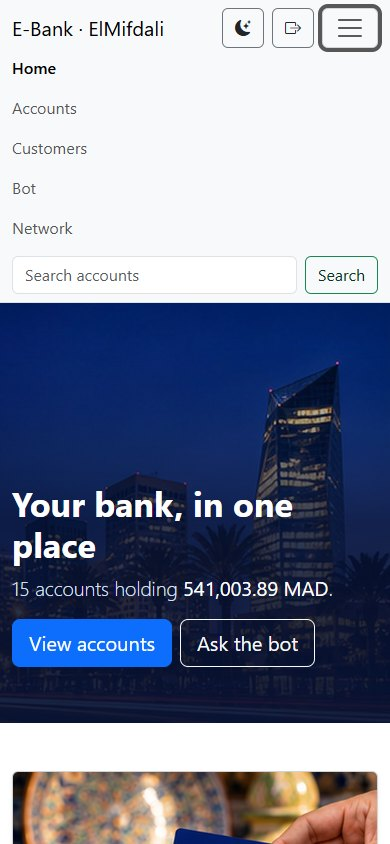 |

| Comptes | Clients | Chatbot |
|---|---|---|
| 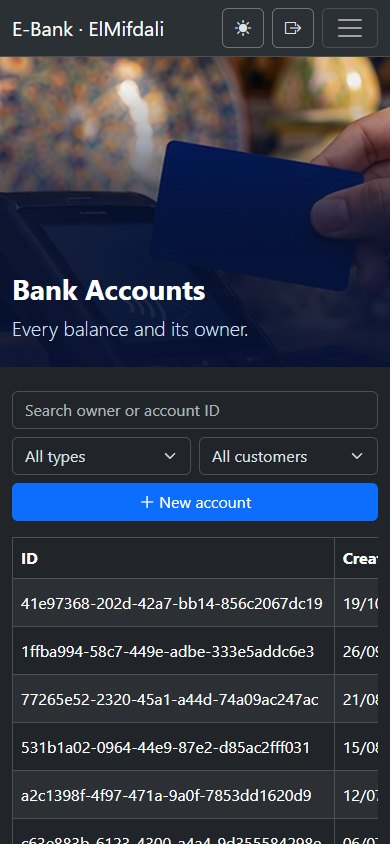 |  | 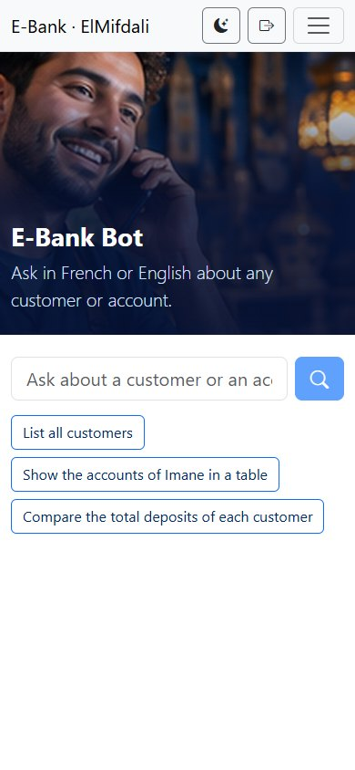 |

---

## 7. Sécurité

| Protection | Détails |
|---|---|
| Mots de passe | Hachés avec BCrypt, jamais retournés par l'API |
| Attaque par force brute | Cinq échecs de connexion bloquent l'adresse e-mail pendant cinq minutes |
| Tokens | JWT HS256, valides 8 heures, vérifiés par la gateway |
| Gateway fermée | Toute route non déclarée est refusée : `/mcp`, console H2, endpoints Actuator internes |
| Réseau | Tous les services écoutent uniquement sur `127.0.0.1` |
| Console H2 | Désactivée, sauf si `H2_CONSOLE=true` |
| Agent | Une mémoire par utilisateur authentifié, appels au chat depuis un autre site refusés |
| Bots | Fermés par défaut, seuls les identifiants listés dans `.env` sont autorisés |
| Secrets | Uniquement dans `.env`, qui est ignoré par Git |

---

## 8. Tests et résultats

Résultats du 22 novembre 2026 :

| Test | Réussis | Échoués | Exécution |
|---|---|---|---|
| Tests unitaires et de contexte Java | 24 | 0 | `.\mvnw.cmd test` dans chaque service |
| Tests unitaires Angular | 4 | 0 | `npm test` dans `angular-front` |
| API, MCP et agent, de bout en bout | 30 | 0 | `node tests/api.test.mjs` |
| Attaques de sécurité | 45 | 0 | `node tests/security.test.mjs` |
| Collection Postman | 15 | 0 | Postman ou Newman |

Les deux scripts Node nécessitent que l'application soit démarrée. Ils créent des utilisateurs, un client et un compte
de test : il faut donc utiliser une base d'utilisateurs temporaire. Dans le terminal qui démarre l'application,
exécuter d'abord :

```powershell
$env:AUTH_DB_URL = 'jdbc:h2:mem:auth-test;DB_CLOSE_DELAY=-1'
```

Les captures des tests de bout en bout proviennent d'une copie séparée des services, sur d'autres ports (18085, 18057...),
afin de ne pas modifier les données réelles.

### Tests unitaires

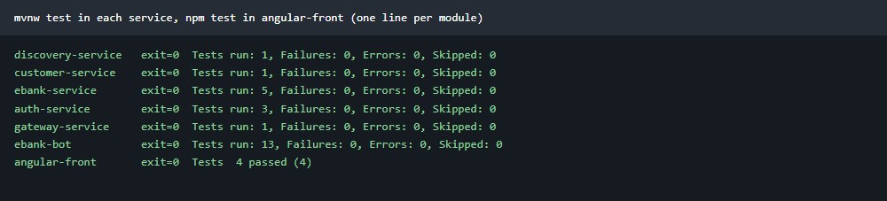

### Tests de l'API, de MCP et de l'agent


### Tests de sécurité


---

## 9. Dépannage

| Problème | Solution |
|---|---|
| `Ports already in use` | L'application tourne déjà, sinon exécuter d'abord `scripts\stop-all.ps1` |
| Un service ne démarre pas | Consulter `.run\<service>.log` |
| Erreur 503 de la gateway juste après le démarrage | Attendre 15 secondes, le temps de l'enregistrement dans Eureka |
| `127.0.0.1:4200` ne répond pas | Utiliser `http://localhost:4200` |
| Erreur 401 sur une adresse de la gateway | Se connecter et envoyer le token Bearer |
| Le bot indique qu'il est indisponible | Gemini est surchargé ou le quota est dépassé : patienter ou changer `GEMINI_MODEL` |
| Telegram répond *Accès non autorisé* | Ajouter l'identifiant à `TELEGRAM_ALLOWED_USERS` et redémarrer |
| `409 Conflict` avec Telegram | Un autre programme utilise le même token |

## 10. Limites connues

- Les clients et les comptes sont stockés en mémoire : un redémarrage restaure les données de démonstration.
- Les ports directs (8085, 8057, 8058) ne demandent pas de token, afin de permettre l'utilisation de Swagger et des
  clients MCP sur cette machine. Ils ne doivent pas être exposés.
- Il n'y a pas de rôles : toute personne inscrite est considérée comme banquier et voit tous les clients.
- Le token est conservé dans `localStorage`. En production, utiliser un fournisseur d'identité comme Keycloak.
- Le service de configuration et le déploiement Docker ne font pas partie de cette version.
- Discord reste à tester avec un vrai bot.
